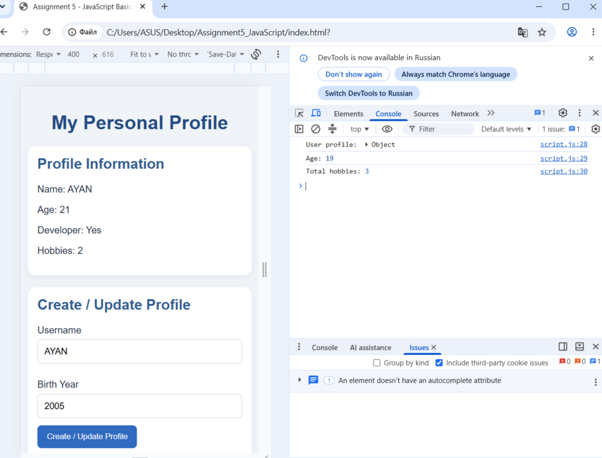
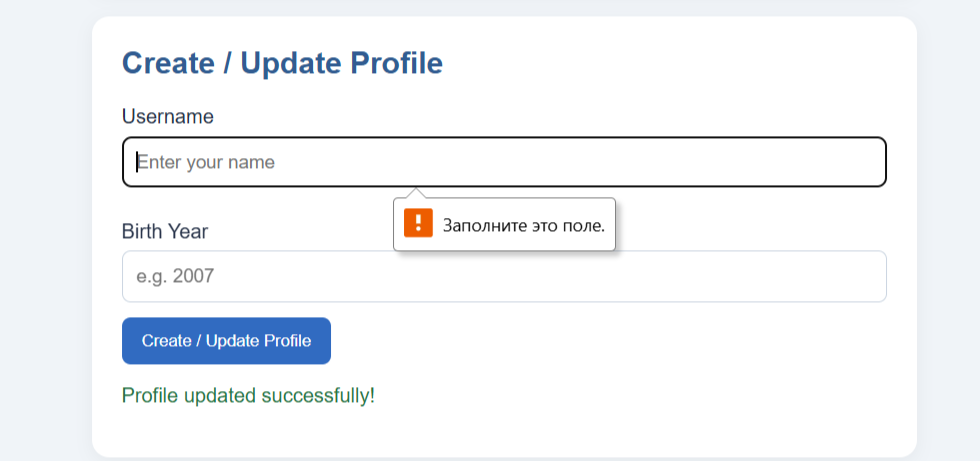
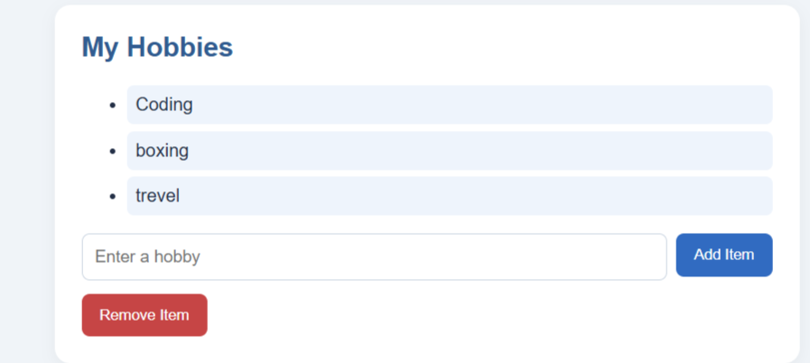

# Assignment 5 — JavaScript Basics

## Student Information
- **Name:** Ayan Sarbasov
- **Group:** SE2538
- **Course:** Web Technologies

## Task 1 — Profile Object
Created a JavaScript object with name, birth year, developer status, and hobbies.

## Task 2 — Arithmetic Calculations
Calculated the user's age and total number of hobbies using JavaScript.

## Task 3 — HTML Form
Created a form with Username and Birth Year inputs.

## Task 4 — Event Listener
Added an event listener to update the profile when the form is submitted.

## Task 5 — DOM Manipulation
Implemented Add Item and Remove Item buttons to manage the hobbies list.

## Summary
In this assignment, I practiced JavaScript objects, arithmetic operations, event listeners, and DOM manipulation. I also learned how to add and remove HTML elements dynamically.
